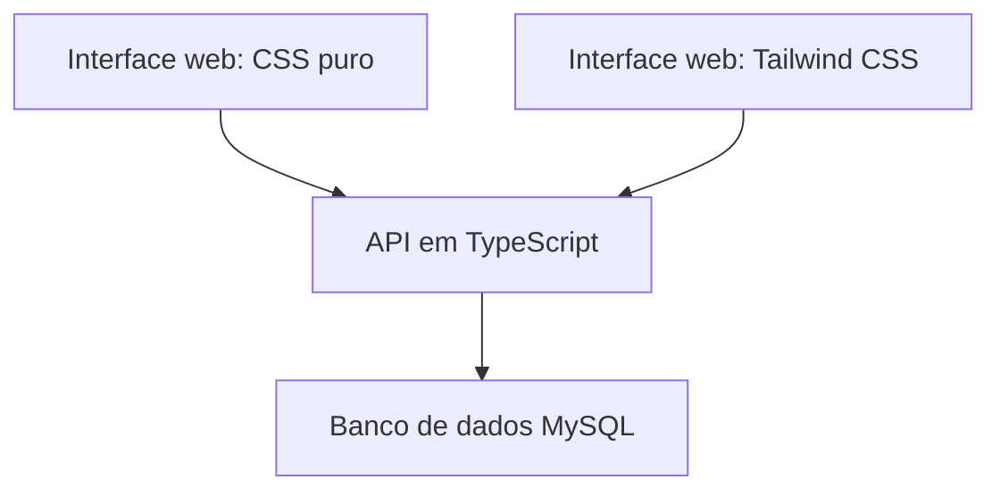

# EduCore

**EduCore** é um projeto acadêmico de gestão educacional desenvolvido para estudar, na prática, a construção de uma aplicação web completa. O projeto reúne uma API em TypeScript, banco de dados relacional MySQL e duas implementações de interface: uma com CSS puro e outra com Tailwind CSS.

A proposta é acompanhar o caminho dos dados desde o cadastro no navegador até sua validação, processamento e armazenamento no banco de dados. O repositório também serve como material de estudo para alunos que desejam compreender a organização de um projeto em camadas e a integração entre frontend, backend e banco de dados.

> **Estado do projeto:** em planejamento e desenvolvimento. As funcionalidades descritas abaixo representam o escopo previsto e serão identificadas como concluídas conforme forem implementadas.

## Objetivos

- Desenvolver uma aplicação web para operações comuns de gestão acadêmica.
- Aplicar conceitos de HTML5, CSS, JavaScript, TypeScript e MySQL em um mesmo projeto.
- Construir duas interfaces com as mesmas funcionalidades para comparar CSS puro e Tailwind CSS.
- Documentar requisitos, regras de negócio, banco de dados, API e decisões técnicas.
- Oferecer uma base que possa ser utilizada e ampliada em atividades acadêmicas.

## Funcionalidades planejadas

O EduCore será organizado em módulos. O escopo inicial contempla:

- Autenticação e gerenciamento de usuários.
- Cadastro e consulta de alunos e professores.
- Cadastro de cursos, disciplinas e turmas.
- Matrícula de alunos em turmas.
- Registro de avaliações e notas.
- Registro e acompanhamento de frequência.

As regras específicas de cada módulo serão registradas em `docs/requisitos/regras-de-negocio.md`.

## Tecnologias

| Camada | Tecnologias |
|---|---|
| Backend | TypeScript |
| Frontend, versão 1 | HTML5, CSS puro e JavaScript |
| Frontend, versão 2 | HTML5, Tailwind CSS e JavaScript |
| Banco de dados | MySQL |
| Versionamento | Git e GitHub |

As bibliotecas e ferramentas de execução do backend serão documentadas no README da API à medida que forem definidas e incorporadas ao projeto.

## Arquitetura

As duas interfaces web consomem a mesma API. A API recebe as requisições, valida os dados, aplica as regras de negócio e acessa o MySQL.



A comparação entre as interfaces se concentra na implementação visual. As regras acadêmicas ficam no backend, de modo que as duas versões apresentem o mesmo comportamento.

## Estrutura do repositório

```text
educore/
├── README.md
├── LICENSE
├── .gitignore
├── .editorconfig
├── .env.example
├── docs/
│   ├── requisitos/
│   ├── arquitetura/
│   ├── banco-de-dados/
│   ├── api/
│   ├── tutoriais/
│   └── imagens/
├── database/
│   └── mysql/
│       ├── migrations/
│       ├── seeds/
│       └── consultas/
├── apps/
│   ├── api-typescript/
│   ├── web-css/
│   └── web-tailwind/
└── .github/
    ├── ISSUE_TEMPLATE/
    └── workflows/
```

| Diretório | Conteúdo |
|---|---|
| `docs/` | Requisitos, arquitetura, modelo de dados, API e materiais de estudo. |
| `database/mysql/migrations/` | Scripts versionados de criação e alteração da estrutura do banco. |
| `database/mysql/seeds/` | Dados fictícios para desenvolvimento e demonstração. |
| `database/mysql/consultas/` | Exemplos de consultas SQL utilizados no projeto. |
| `apps/api-typescript/` | Código e documentação da API. |
| `apps/web-css/` | Interface desenvolvida com CSS puro. |
| `apps/web-tailwind/` | Interface desenvolvida com Tailwind CSS. |
| `.github/` | Modelos de issues e fluxos de verificação automática, quando configurados. |

A estrutura será preenchida gradualmente, conforme os módulos forem desenvolvidos.

## Como executar

As instruções completas de instalação e execução ficarão em:

- `docs/tutoriais/instalacao.md`
- `docs/tutoriais/execucao-local.md`
- `apps/api-typescript/README.md`
- `apps/web-css/README.md`
- `apps/web-tailwind/README.md`

A aplicação precisará de uma instância MySQL e das variáveis de ambiente exigidas pela API. O arquivo `.env.example` servirá de referência para a configuração local. Credenciais reais não devem ser enviadas ao repositório.

> Os comandos de instalação e inicialização serão adicionados após a configuração de cada aplicação.

## Banco de dados

O MySQL é o banco de dados relacional do EduCore. Sua estrutura será mantida por scripts de migração, enquanto os dados fictícios de exemplo ficarão separados em `seeds/`.

A documentação do banco incluirá:

- Modelo conceitual e modelo lógico.
- Diagrama entidade-relacionamento.
- Dicionário de dados.
- Relacionamentos e restrições.
- Consultas SQL de exemplo.

## Proposta didática

O EduCore foi pensado para permitir diferentes níveis de estudo:

- **Nível 1:** executar a aplicação, conhecer as entidades e acompanhar o fluxo de uma operação.
- **Nível 2:** implementar funcionalidades, consultas SQL e documentação dos módulos.
- **Nível 3:** aprofundar validações, testes, organização da API e verificações automáticas.

O objetivo é que cada implementação possa ser estudada, explicada e ampliada pelos alunos.

## Acompanhamento do desenvolvimento

| Etapa | Estado |
|---|---|
| Definição da estrutura do repositório | Planejada |
| Requisitos e regras de negócio | Planejados |
| Modelo e scripts iniciais do MySQL | Planejados |
| API em TypeScript | Planejada |
| Interface com CSS puro | Planejada |
| Interface com Tailwind CSS | Planejada |
| Testes e documentação de execução | Planejados |

Esta tabela será atualizada conforme as entregas forem concluídas.

## Licença

Cons
